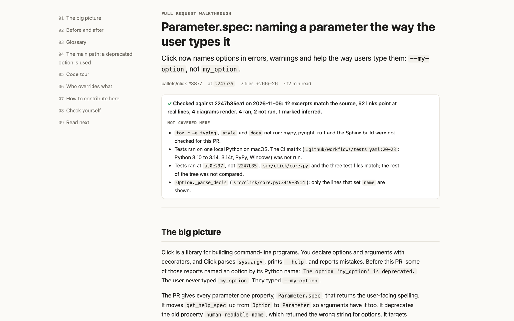
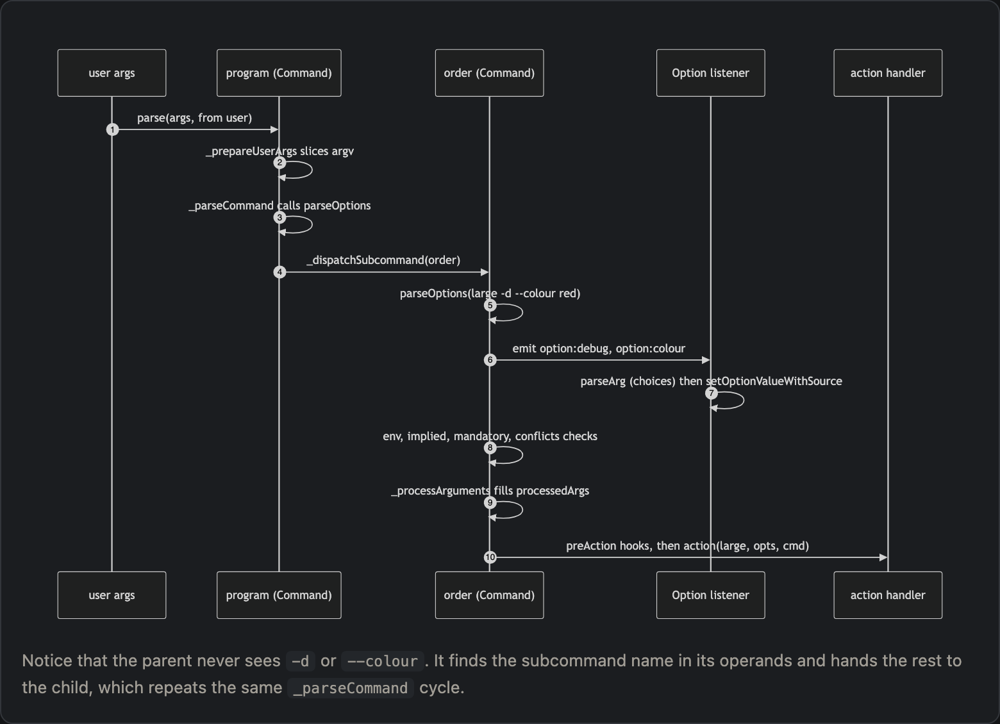
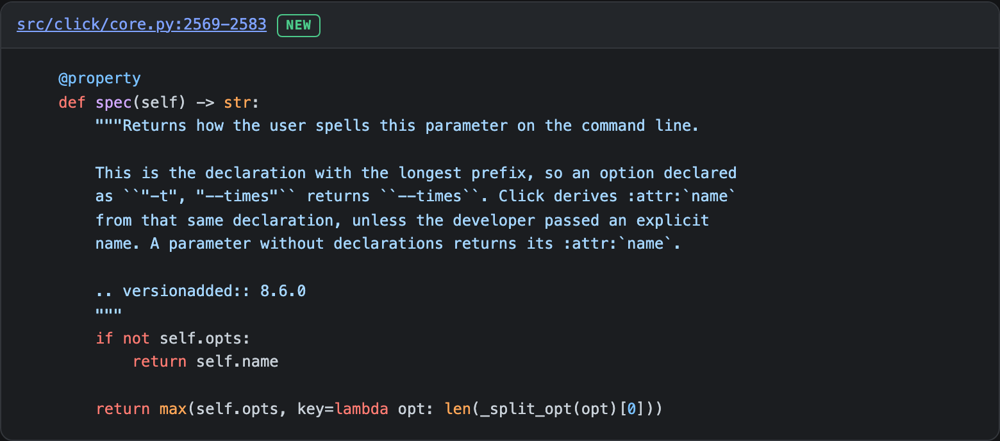
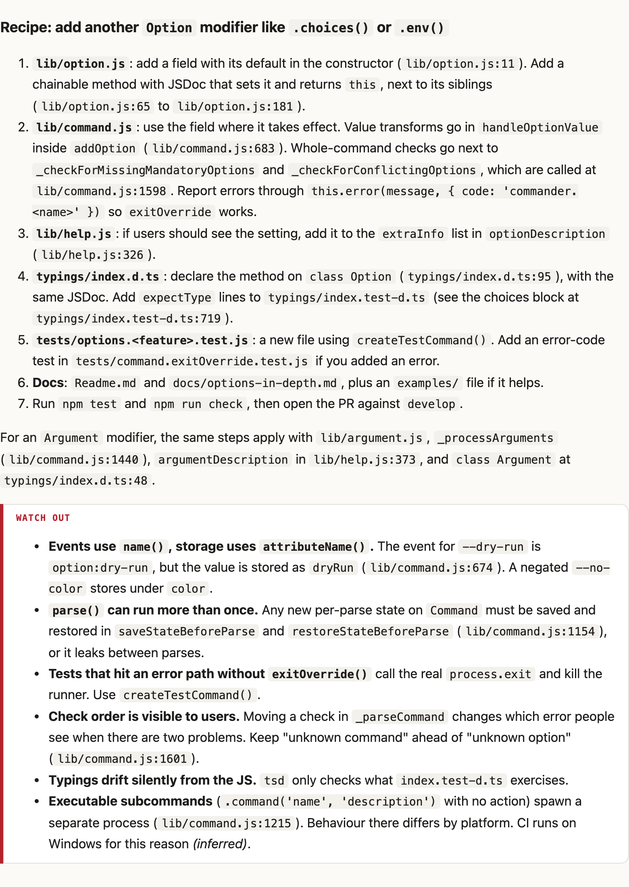
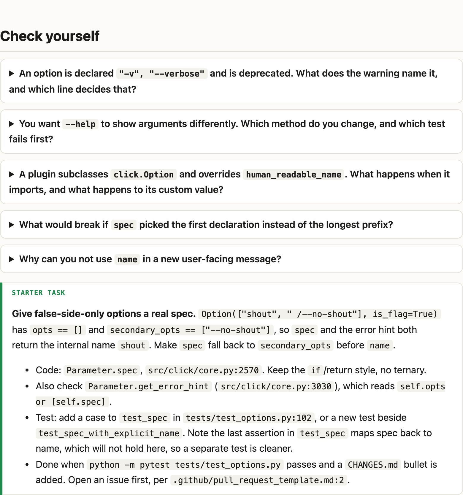

# walkthrough-buddy

An agent skill that turns a pull request, a folder, a feature or a whole repository into one page a newcomer reads once and then ships a change from.

It works with Claude Code, Codex, and other agents that load [Agent Skills](https://agentskills.io) (`SKILL.md`).



## Why

Most "explain this code" output reads well and is hard to trust. Excerpts get retyped from memory, line numbers drift, the test command is a guess, and the diagram turns out to be the folder tree. A newcomer can't tell which parts are real, so they end up reading the code anyway.

This skill keeps the friendly parts (diagrams, an analogy per idea, plain words) and makes every claim checkable:

- **Every code excerpt is copied from git at a pinned commit**, and a checker fails the page if one line doesn't match.
- **Every `path:line` link points at a line that exists.**
- **Every diagram is rendered in a real browser** before the page is handed over.
- **Every command the reader is told to run** comes from the repo. It is marked ✅ if the agent ran it, or ⚠️ if not.
- **The page ends with how to change the code, not how it works**: a recipe for adding another one of these, the test that proves it, the traps, and a starter task.

## What a page looks like

Both examples below were made from public repos, and both are in [`examples/`](examples). Download one and open it in a browser.

**Diagrams of what calls what, not of where the files live.** Each one has a caption that tells you what to notice.



**Real code with a pinned permalink.** The tag says whether the code is new, changed or context.



**A contributor kit.** It covers which files to touch, in order, for the most common kind of change, plus the gotchas that cost people an afternoon.



**A check at the end.** Questions with hidden answers, and a small real task with the files and test named.



## Install

The skill is the folder `skills/walkthrough-buddy`. Put it where your agent looks for skills.

**Claude Code**

```bash
git clone https://github.com/Arya-A-Nair/walkthrough-buddy
ln -s "$PWD/walkthrough-buddy/skills/walkthrough-buddy" ~/.claude/skills/walkthrough-buddy
```

**Codex**

```bash
git clone https://github.com/Arya-A-Nair/walkthrough-buddy
ln -s "$PWD/walkthrough-buddy/skills/walkthrough-buddy" ~/.agents/skills/walkthrough-buddy
```

To scope it to one repo, use `.claude/skills/` or `.agents/skills/` inside that repo instead. Copying the folder works as well as linking it.

**Any agent with the `skills` CLI**

```bash
npx skills add Arya-A-Nair/walkthrough-buddy
```

## Use

Ask for what you want; the skill triggers on intent:

```text
walk me through PR #482
onboard me to src/billing before I touch it
explain this codebase like I'm new here, I need to fix a bug in the parser tomorrow
ELI5 how the retry queue works, end to end
I'm handing this service over, write the walkthrough for whoever picks it up
```

You can also say who the reader is ("for a designer", "for a new grad") and it adjusts the depth and vocabulary. Ask for Markdown if you want to commit the result or paste it into a PR comment; GitHub renders the diagrams.

The page lands in `.walkthroughs/` at the repo root, which is excluded locally through `.git/info/exclude`, so it never shows up in `git status`.

## How it works

1. **Gather.** `scripts/gather.sh` resolves the target and collects the facts: base and head commits, the diff, the PR description and review threads (if `gh` is available), contributing docs, build and test entry points, and the tests next to the code.
2. **Understand.** The agent reads whole files, traces one real input from where it enters to where it ends, and runs the safe commands in a throwaway worktree, so your checkout stays untouched.
3. **Write.** It fills a fixed set of sections (big picture, before/after, glossary, main flow, code tour, contribute, check yourself) using `assets/template.html`. `scripts/excerpt.py` produces each code excerpt straight from git.
4. **Check.** `scripts/check.py` verifies the excerpts, citations, required sections and diagram rendering. The page isn't delivered until it passes.

| File | What it's for |
|---|---|
| `SKILL.md` | The workflow the agent follows |
| `references/sections.md` | The section contract, the Mermaid rules that prevent most render failures, and the writing rules |
| `assets/template.html` | A self-contained page: light and dark themes, sticky contents, needs no build; Mermaid and highlight.js load from pinned CDN versions |
| `scripts/gather.sh` | Read-only fact collection for a PR, range, commit, branch, path or concept |
| `scripts/excerpt.py` | Copies an excerpt from git, escapes it and adds a permalink |
| `scripts/check.py` | Verifies a finished page; exit 0 means it passed |

## Does it help?

Each target got two walkthroughs from the same model, one with the skill and one without. A separate agent wrote a quiz and a contribution task with a hidden test, without seeing either walkthrough. Fresh readers then took the quiz closed book and did the task. A grader scored the quiz blind.

| | click PR, with | click PR, without | commander.js, with | commander.js, without |
|---|---|---|---|---|
| Closed-book quiz | **0.88** | 0.83 | **0.86** | 0.77 |
| Contribution passes hidden test + full suite | yes | yes | yes | yes |
| Code shown that is verbatim from the repo | **100%** | 44% | **96%** | 21% |
| `path:line` links, all valid | **53** | 0 | **60** | 0 |

Readers scored higher with the skill's pages. Every reader could do the task either way, because the repos are small and well tested. The clearest difference is that a reader can verify the skill's page against the source and can't do that with the other. There is one run per cell, so treat the numbers as a direction. The method, every artifact and the caveats are in [`evals/`](evals).

## Requirements

- `git`, `bash` and `python3` (standard library only)
- Optional: `gh`, for PR descriptions and review comments
- Optional: Chrome, Chromium, Edge or Brave, for the diagram render check. Without one, the checker says the diagrams are unverified instead of failing silently.

## Limits

- It explains code; it doesn't review it. Risks show up as "watch out" notes, credited to whoever raised them.
- Commands that take a long time or touch real services are marked *not run here*. The skill won't claim it ran them.
- The rendered page loads Mermaid and highlight.js from a CDN. Without network the text still reads fine, but the diagrams stay as source.
- For a private repo, the page contains your code. It stays on disk unless you share it.

## License

MIT
