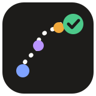
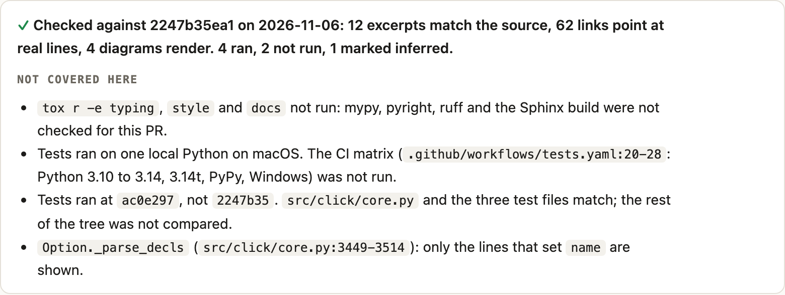
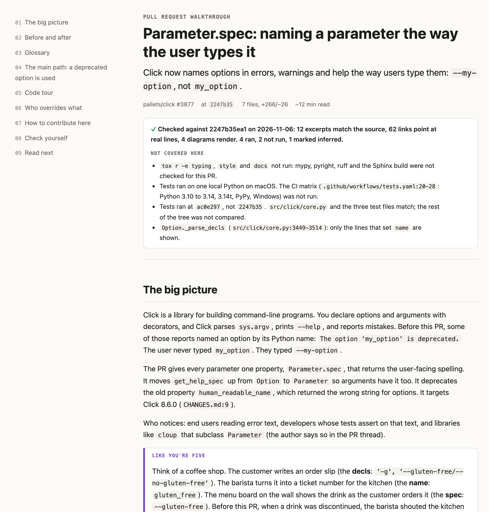
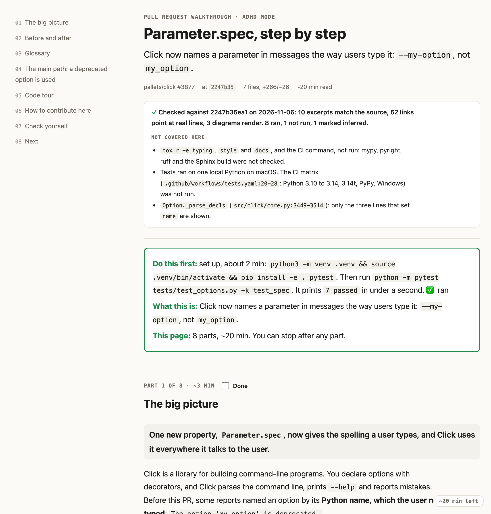
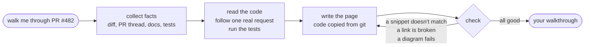

<p align="center">
  
</p>

<h1 align="center">walkthrough-buddy</h1>

<p align="center">
  <strong>Understand any PR or codebase from one page, then make your first change.</strong>
</p>

<p align="center">
  
  
  
  <a href="LICENSE"></a>
</p>

<p align="center">
  <a href="#before--after">Before/After</a> •
  <a href="#whats-on-the-page">What's on the page</a> •
  <a href="#adhd-mode">ADHD mode</a> •
  <a href="#install">Install</a> •
  <a href="#usage">Usage</a> •
  <a href="#how-it-works">How it works</a>
</p>

---

A skill for Claude Code and Codex. Point it at a pull request, a folder, a feature or a whole repo, and it builds a walkthrough page for someone who has never seen the code. The page has diagrams of how things connect, an "explain like I'm five" analogy for each hard idea, the real code with links to the exact lines, and a short "how to make your first change here" section at the end.

## Before / After

You join a team and ask your agent: *"walk me through PR #3877"*

<table>
<tr>
<td width="50%" valign="top">

### Usual answer

> This PR introduces a new `spec` property on the `Parameter` class that returns the user-facing name of a parameter. Previously, `human_readable_name` was used, which returned the internal name for options. The PR deprecates `human_readable_name` and updates error messages, help output and warnings to use `spec`. It also moves `get_help_spec` from `Option` to `Parameter`. Tests were added in `test_options.py`. To contribute, run the tests with `pytest`…

A summary you read once and forget. You still don't know where to start, which test to run, or whether the code it quoted is real.

</td>
<td width="50%" valign="top">

### With walkthrough-buddy


- one sentence on what changed for users
- before/after diagrams
- an ELI5: *"a coffee shop: the order slip, the ticket number, the menu board"*
- every snippet copied from the real code, with line links
- the exact test command, already run
- "to add another one of these, touch these 5 files"
- a starter task, with what "done" looks like

</td>
</tr>
</table>

## What's on the page

<table>
<tr>
<td width="50%" valign="top">

**Diagrams of the real flow, not the folder tree**


</td>
<td width="50%" valign="top">

**Real code, linked to the exact lines**


**What the page did not cover**



</td>
</tr>
<tr>
<td width="50%" valign="top">

**How to change it: files in order, plus the traps**


</td>
<td width="50%" valign="top">

**Check yourself, then a starter task**


</td>
</tr>
</table>

Every page follows the same order: **big picture → before/after → glossary → main flow → code tour → how to contribute → check yourself**. Open one of the [`examples/`](examples) in a browser to read a full page.

## ADHD mode

Say *"I have ADHD"* or *"make it easier to read"*. You get the same content, cut into short timed parts. It also switches on by itself if you use the [`i-have-adhd`](https://github.com/ayghri/i-have-adhd) skill.

<table>
<tr>
<td width="50%" valign="top" align="center"><strong>Standard</strong><br><br></td>
<td width="50%" valign="top" align="center"><strong>ADHD mode</strong><br><br></td>
</tr>
</table>

- **Do this first:** one small action at the top that shows the code working
- **Part 3 of 8 · ~2 min:** each part opens with a one-line summary and ends with "You can now…"
- **Progress you can see:** a reading bar, a Done tick per part, and "~6 min left"
- **Less to hold in your head:** short lists, short code snippets, short paragraphs
- **Side notes folded away:** under "Extra, skip if busy"

## Install

Paste this into Claude Code or Codex:

```text
Install the walkthrough-buddy skill from https://github.com/Arya-A-Nair/walkthrough-buddy
```

Or by hand:

```bash
git clone https://github.com/Arya-A-Nair/walkthrough-buddy
ln -s "$PWD/walkthrough-buddy/skills/walkthrough-buddy" ~/.claude/skills/   # Claude Code
ln -s "$PWD/walkthrough-buddy/skills/walkthrough-buddy" ~/.agents/skills/   # Codex
```

## Usage

Just ask. It picks up on what you mean:

```text
walk me through PR #482
onboard me to src/billing before I touch it
explain this codebase, I start on the parser tomorrow
ELI5 how the retry queue works, end to end
I have ADHD, give me the short version of how auth works here
I'm leaving this team, write the handover walkthrough for this service
```

| You can point it at | Example |
|---|---|
| a pull request | `#482`, or a GitHub/GitLab URL |
| a branch, commit or range | `feature/retries`, `a1b2c3d`, `main..feature` |
| a folder or file | `src/billing` |
| a whole repo | `.` |
| an idea | "how payments get retried" |

Want it as Markdown, to paste into a PR or commit to the repo? Say so. GitHub renders the diagrams.

## How it works



- **It reads before it writes.** It reads whole files, not just the diff, and follows one real input from start to finish.
- **It runs things safely.** Tests and commands run in a temporary copy of the repo, so your checkout stays exactly as it was.
- **It checks itself.** A script compares every snippet against the code, follows every link, and renders every diagram. The page is only handed over once that passes.
- **It stays out of git.** The page is saved to `.walkthroughs/`, which is excluded locally, so it never shows up in `git status`.

<details>
<summary>What's in the skill folder</summary>

| File | What it does |
|---|---|
| `SKILL.md` | The steps the agent follows |
| `references/sections.md` | What goes in each part of the page, plus rules for diagrams and writing |
| `references/adhd-mode.md` | How ADHD mode reshapes the page |
| `assets/template.html` | The page design: light and dark themes, contents sidebar, progress tracking |
| `scripts/gather.sh` | Collects the facts about the PR or folder |
| `scripts/excerpt.py` | Copies a code snippet from git and adds a link to its lines |
| `scripts/check.py` | Checks the finished page before it's handed over |

</details>

## Requirements

`git`, `bash` and `python3`. Optional: the `gh` CLI, to read PR descriptions and review comments, and Chrome, Edge or Brave, to check that diagrams render.

## License

MIT
