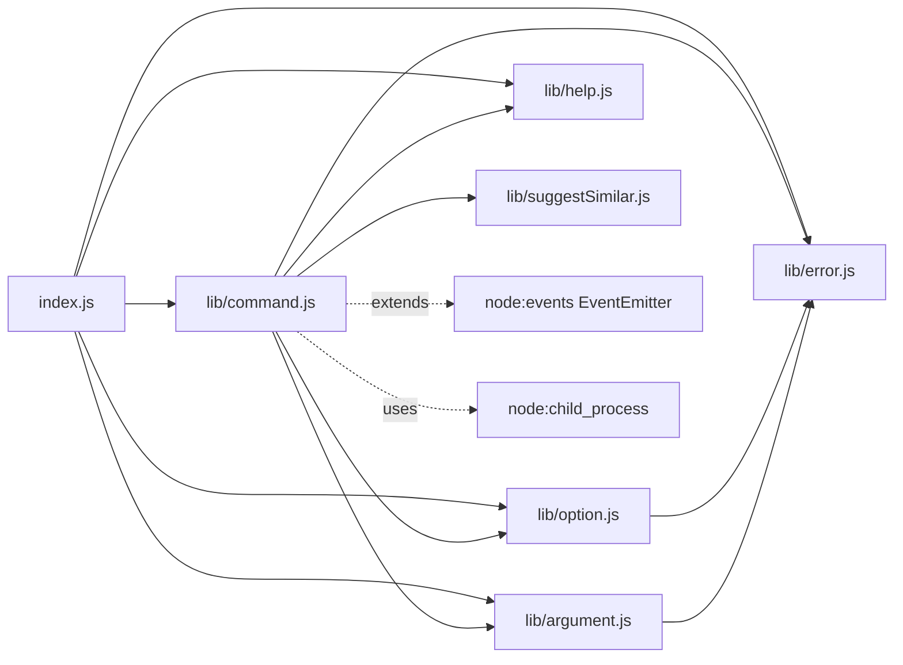
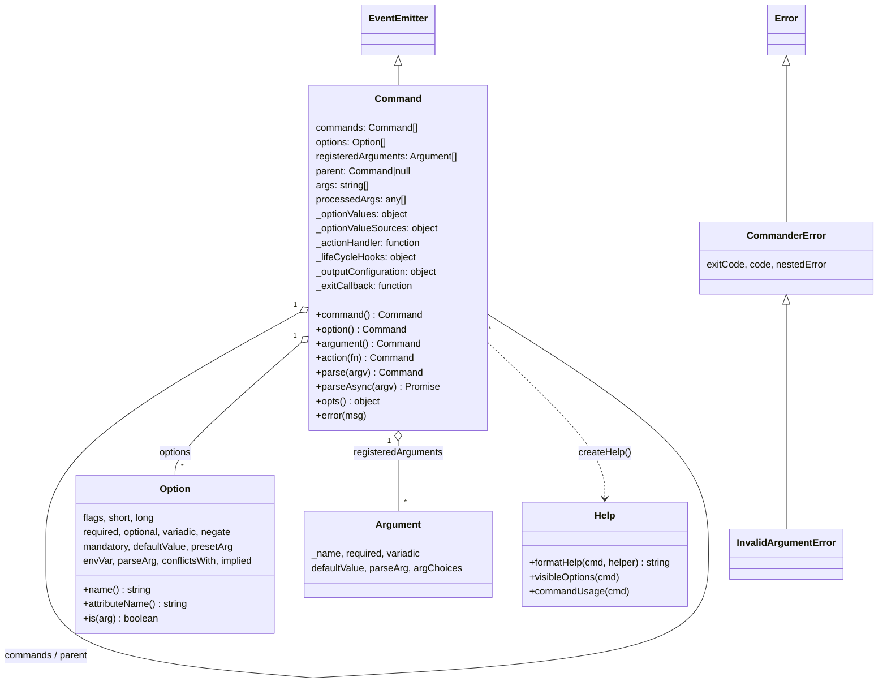
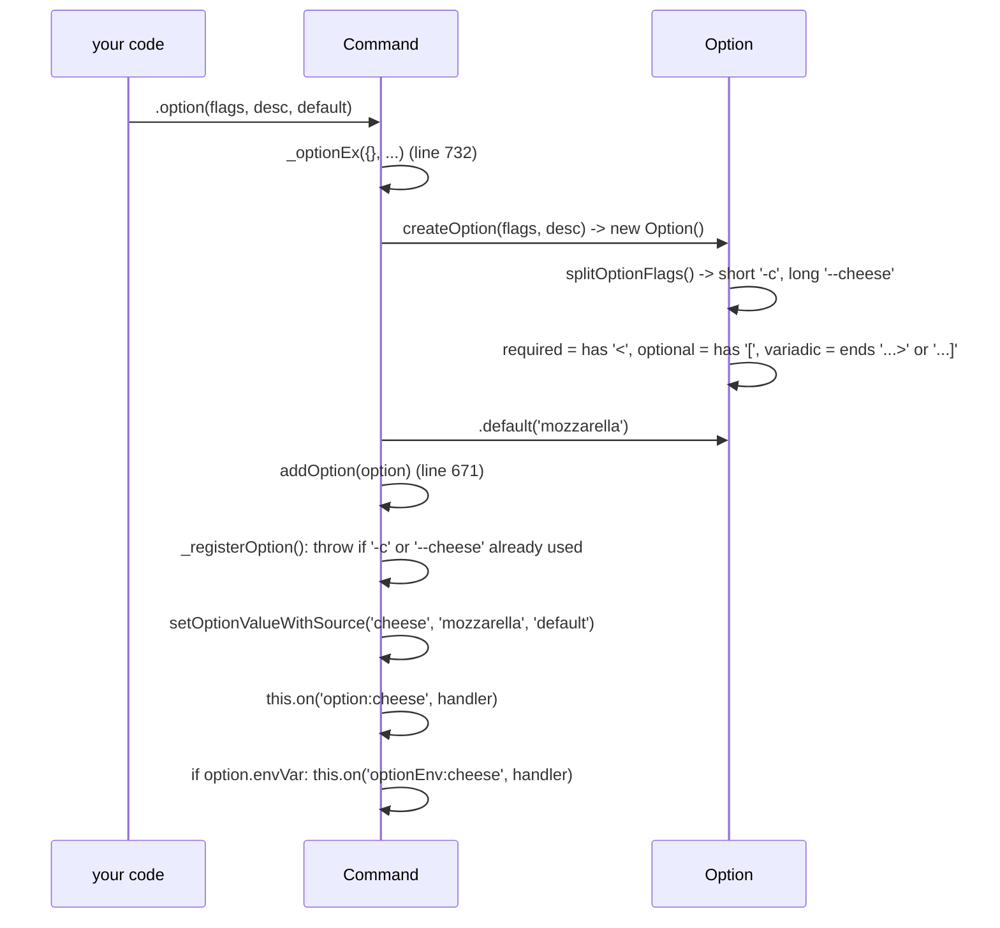
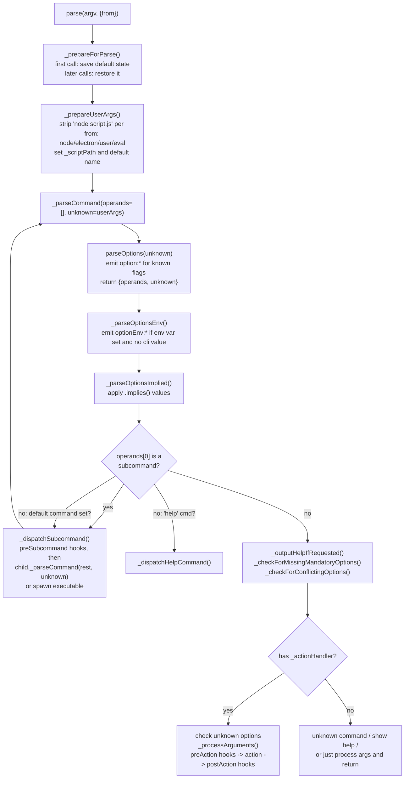
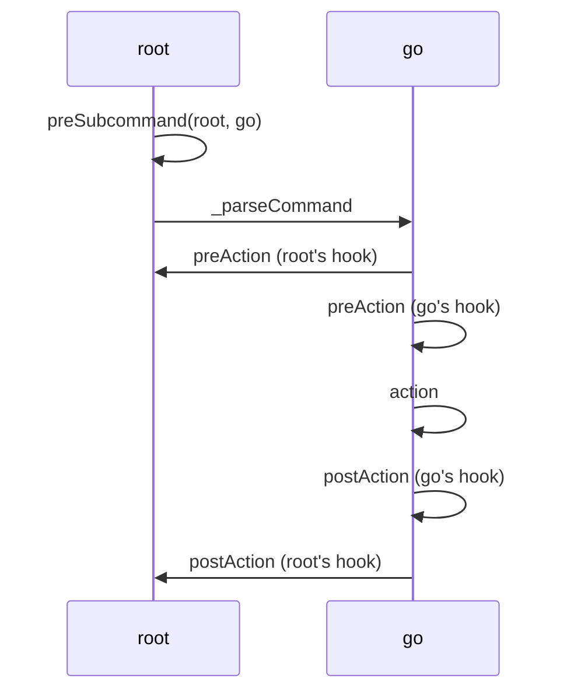
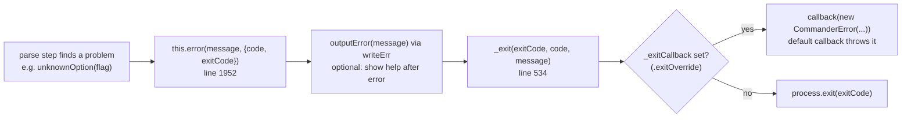
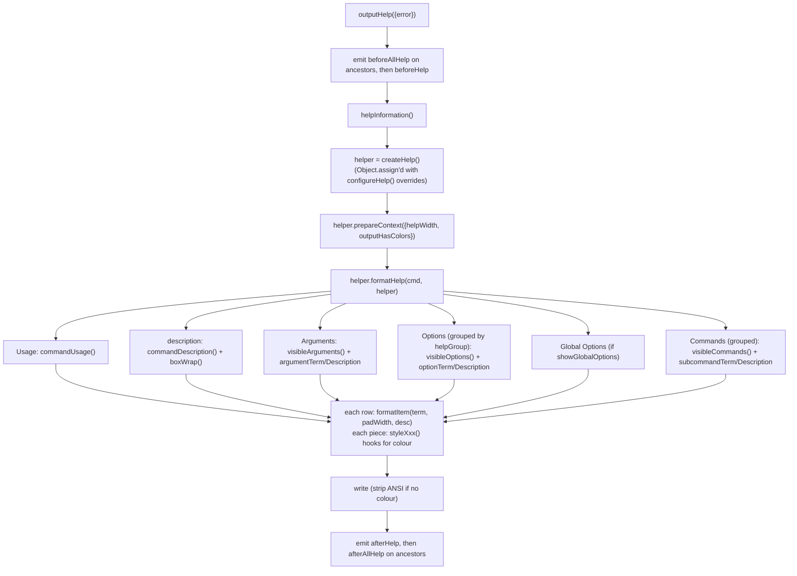
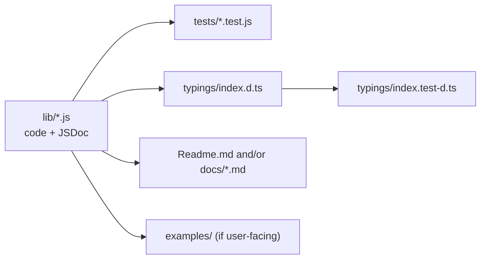

# Commander.js: a walkthrough for first-time contributors

Pinned to `tj/commander.js` @ `ba6d13ddb4243e5913367734f8c159089ffe7834` (package version 15.0.0, ESM-only, Node >= 22.12).
Line numbers below are for that commit. Every "Output:" block in this document was produced by running the snippet against that commit. Nothing is paraphrased from memory.

---

## 0. The 60-second version

- Commander turns `process.argv` (an array of strings) into **option values**, **positional arguments**, and a call to **your action function**.
- Almost all of it lives in one class, `Command` (`lib/command.js`, 2790 lines). Four small helper classes sit around it: `Option`, `Argument`, `Help`, and `CommanderError`.
- You use it in two phases:
  1. **Define**: `.option()`, `.argument()`, `.command()`, `.action()`. This builds a tree of `Command` objects. Nothing is parsed yet.
  2. **Parse**: `.parse(argv)` walks the strings, fills in values, picks a subcommand, and calls the action.
- The hidden wiring is **Node's `EventEmitter`**. `Command extends EventEmitter`. Every option you add registers a listener named `option:<name>`. The parser does not set values itself. It *emits* `option:verbose` and the listener stores the value.
- Errors never throw by default. They print and call `process.exit`. In tests you call `.exitOverride()` so they throw a `CommanderError` instead.
- There are zero runtime dependencies. Keeping it that way is a project rule.

---

## 1. ELI5: Commander is a waiter

Picture a restaurant.

| Restaurant | Commander | Code |
|---|---|---|
| The menu | Your program definition | `new Command()` + `.option()` / `.argument()` / `.command()` |
| A section of the menu (Drinks, Mains) | A subcommand | `program.command('install')` |
| "No onions, extra cheese" | Options | `--no-onion --cheese extra` |
| "One burger" (the actual dish) | Command-arguments (positionals) | `burger` |
| Writing the order on the pad | Parsing | `program.parse()` |
| Handing the ticket to the kitchen | Calling your action | `.action((dish, opts) => ...)` |
| "Sorry, we don't serve *pizzza*. Did you mean *pizza*?" | Error + suggestion | `unknownCommand()` + `suggestSimilar()` |
| The waiter reading the menu aloud | Help | `Help.formatHelp()` |

The waiter (`Command`) does three things in order:

1. **Listens to the whole order and sorts the words.** "Is this a special request (option), a dish (argument), or a section name (subcommand)?" This is `parseOptions()`.
2. **Walks to the right section** if you named one, and hands the rest of the order to the waiter for that section. This is `_dispatchSubcommand()`.
3. **Checks the order makes sense** (you didn't forget a required dish, didn't ask for two incompatible things) and **hands it to the kitchen** (your action). This is the tail of `_parseCommand()`.

Keep that picture. Each section below zooms into one of those steps.

---

## 2. Repo map

```
commander.js/
├── index.js               21 lines. Public entry: exports `program`, classes, factory fns
├── lib/
│   ├── command.js       2790 lines. Command class: definition API, parser, dispatch, errors, help plumbing
│   ├── help.js           731 lines. Help class: pure formatting of help text (no I/O)
│   ├── option.js         377 lines. Option class, DualOptions helper, flag-string parsing
│   ├── argument.js       147 lines. Argument class + humanReadableArgName()
│   ├── error.js           36 lines. CommanderError, InvalidArgumentError
│   └── suggestSimilar.js  99 lines. "Did you mean ...?" via Damerau-Levenshtein distance
├── typings/
│   ├── index.d.ts       Hand-written TypeScript types (NOT generated). Must be kept in sync by hand.
│   └── index.test-d.ts  Type tests run by `tsd`
├── tests/               ~112 files, node:test runner. One file per feature, e.g. command.hook.test.js
│   ├── fixtures/        Tiny scripts used by executable-subcommand tests (pm, pm-install, ...)
│   └── fixtures-extensions/
├── examples/            Runnable example programs (also good reading)
├── docs/                In-depth docs: options-in-depth, parsing-and-hooks, help-in-depth, terminology, deprecated
├── Readme.md            The user manual. Update it when you change behaviour.
├── CHANGELOG.md         Maintainers edit this. You don't.
└── .github/workflows/tests.yml   CI: Node 22/24/26 x ubuntu/windows/macos; npm ci, npm test, npm run check
```

How the modules depend on each other:



`help.js` imports only `humanReadableArgName` from `argument.js`. It never touches `process`. That is why help formatting is easy to unit test.

### Words the codebase uses (from `docs/terminology.md`)

```
my-utility command -o --option option-argument command-argument-1 command-argument-2
           ^^^^^^^ ^^ ^^^^^^^^ ^^^^^^^^^^^^^^^ ^^^^^^^^^^^^^^^^^^
           command option       option-argument command-argument
```

In the parser code, command-arguments are called **operands**. Anything the current command didn't recognise is **unknown**.

---

## 3. The object model



Three things to know about this picture:

- **It is a tree.** `program` is the root. Each `.command('x')` makes a child with `parent` pointing back up. Lots of code walks up with `_getCommandAndAncestors()` (line 122), e.g. for global options, hooks, and mandatory checks.
- **Option values do not live on `Option`.** `Option` is only the *description* of a flag. The *values* live on the owning `Command` in `_optionValues` (keyed by camelCase attribute name), with a parallel `_optionValueSources` saying where each value came from.
- **Factories are override points.** `createCommand`, `createOption`, `createArgument`, `createHelp` exist so users can subclass. Internal code always goes through them (e.g. `.option()` calls `this.createOption()`), so do the same in your changes.

---

## 4. Phase 1: defining a program

### 4.1 What `.option('-c, --cheese [type]', 'desc', 'mozzarella')` actually does



ELI5: adding an option is like putting a labelled tray on the counter and telling a helper "whenever someone shouts *cheese!*, put what they hand you in this tray". The helper is the `option:cheese` listener. The parser only ever shouts.

The shared handler (`handleOptionValue`, line 683) decides the final value:

1. No value given and the option has a `.preset()`? Use the preset.
2. Has a custom `parseArg`? Call it with `(value, previousValue)`. This is how "collect into array" and "increase verbosity" parsers work.
3. Else, variadic? Append to an array.
4. Still nothing? `--no-x` gives `false`. A boolean or optional-value option gives `true`.
5. Store with source `'cli'` (or `'env'`).

You can see what `Option` derives from a flags string:

```js
const o = new Option('-c, --cheese-type [type...]');
console.log(o.short, o.long, o.required, o.optional, o.variadic, o.name(), o.attributeName());
```
Output:
```
-c --cheese-type false true true cheese-type cheeseType
```

`name()` is used for event names (`option:cheese-type`). `attributeName()` is the camelCase key in `opts()`. For `--no-sauce` the attribute name is `sauce` (the `no-` is stripped), which is how `--sauce` and `--no-sauce` share one value. `DualOptions` (option.js) exists only to untangle that pair when working out implied values.

### 4.2 `.command()` vs `.addCommand()`: one real gotcha

`command('install <pkg>')` (line 156) creates a child with `createCommand()`, parses `<pkg>` into an `Argument`, registers it, sets `parent`, and calls **`copyInheritedSettings(this)`** (line 100). That copies output config, help config, `exitOverride` callback, and a handful of parse settings down to the child.

`addCommand(cmd)` (line 289) attaches a command you built yourself. It does **not** copy settings.

```js
const p = new Command('p').exitOverride();
const viaCommand = p.command('one').action(() => {});
const added = new Command('two').action(() => {});
p.addCommand(added);
console.log(!!viaCommand._exitCallback, !!added._exitCallback);
```
Output:
```
true false
```

Also note: `.command('x', 'description')` (with a description as the 2nd arg) means **executable subcommand** (section 9) and returns the *parent*, not the child. Without a description it returns the *child*. This trips people up when chaining.

### 4.3 `.action(fn)`

`action()` (line 557) does not call anything. It stores a wrapper in `_actionHandler`. When called, the wrapper passes your function: one parameter per declared argument, then `opts()`, then the command itself.

```js
.argument('<topping>').argument('[extras...]')
.action((topping, extras, options, command) => { ... })
```

---

## 5. Phase 2: parsing, end to end

### 5.1 The big picture



The key trick is in the loop from `I` back to `D`: **each level of the tree only eats what it understands and passes the rest down.** The root parses root options. As soon as it hits something it doesn't know, everything from there on goes into `unknown`, and the subcommand gets a fresh look at it.

### 5.2 `parseOptions()`: the sorting step (line 1760)

ELI5: the waiter reads the order one word at a time and drops each word in one of two buckets: **operands** (dishes, section names) and **unknown** (things I don't understand, so pass them to whoever is next). Once one word goes into *unknown*, every word after it does too, because the next waiter needs the full context.

Rules, in the order the loop applies them:

| Token | What happens |
|---|---|
| `--` | Stop. Everything after is an operand (literal). |
| `--known` (boolean) | emit `option:known` |
| `--known <v>` (required value) | consume next token as the value, even if it starts with `-` |
| `--known [v]` (optional value) | consume next token only if it doesn't look like an option (negative numbers are allowed) |
| `-abc` | if `-a` is a boolean, emit it and re-loop on `-bc` (the `activeGroup` variable) |
| `-p80` | if `-p` takes a value, value is `80` |
| `--port=80` | split on `=` |
| unknown `-x...` | switch the bucket to `unknown` for the rest |
| anything else | push to the current bucket |

`enablePositionalOptions()` and `passThroughOptions()` add early `break`s so that a subcommand name, or the first operand, stops option parsing for this level.

Real outputs from `program.parseOptions()` (the method is public, which makes it handy for experiments):

```js
const p = new Command();
p.option('-k, --known <v>');
p.command('sub').option('--unknown <u>').argument('[op]').action(() => {});
p.parseOptions(['--known', 'kkk', 'op']);
p.parseOptions(['sub', '--unknown', 'uuu', 'op']);
p.parseOptions(['sub', '--', '--unknown', 'uuu', 'op']);
```
Output:
```
{"operands":["op"],"unknown":[]}
{"operands":["sub"],"unknown":["--unknown","uuu","op"]}
{"operands":["sub","--unknown","uuu","op"],"unknown":[]}
```

Note the second line: `--unknown` belongs to `sub`, not to the root, so the root puts it (and everything after) in `unknown`. Then `_parseCommand` sees `operands[0] === 'sub'` and hands `['--unknown','uuu','op']` to `sub`, which does recognise it.

Combined short flags:
```js
const c = new Command().option('-a').option('-b').option('-p, --port <p>').action(() => {});
c.parse(['-abp80'], { from: 'user' });
c.opts();
```
Output:
```
{"a":true,"b":true,"port":"80"}
```

Negative numbers are treated as operands, not options, when it's safe:
```js
new Command().argument('<n>').action((n) => console.log(n)).parse(['-5'], { from: 'user' });
```
Output: `-5`

### 5.3 Where an option value comes from

Every value has a **source**: `default`, `config` (set by your code via `setOptionValueWithSource`), `env`, `cli`, or `implied`. The order of steps in `_parseCommand` (cli, then env, then implied) plus a priority check in each step gives this precedence:

```
cli  >  env  >  implied  >  default
```

- `_parseOptionsEnv` (line 1978) only applies an env var if the current value is `undefined` or came from `default`/`config`/`env`. So it never overwrites `cli`.
- `_parseOptionsImplied` (line 2008) only fills keys whose value is `undefined` or came from `default`/`implied`.

One example that exercises all of it:

```js
process.env.PIZZA_SIZE = 'large';
const pizza = new Command('pizza')
  .argument('<topping>')
  .argument('[extras...]')
  .option('-c, --cheese [type]', 'cheese', 'mozzarella')
  .option('--no-sauce')
  .addOption(new Option('-s, --size <size>').choices(['small', 'large']).env('PIZZA_SIZE'))
  .addOption(new Option('--vegan').implies({ cheese: false }))
  .option('-n, --count <n>', 'count', (v) => {
    const n = parseInt(v);
    if (isNaN(n)) throw new InvalidArgumentError('Not a number.');
    return n;
  }, 1)
  .action((topping, extras, opts, cmd) => {
    console.log(topping, JSON.stringify(extras), JSON.stringify(opts));
    console.log(['cheese', 'sauce', 'size', 'vegan', 'count']
      .map((k) => k + '=' + cmd.getOptionValueSource(k)).join(' '));
  });
pizza.parse(['ham', 'olives', 'onion', '--vegan', '-n', '3', '--no-sauce'], { from: 'user' });
```
Output:
```
ham ["olives","onion"] {"cheese":false,"count":3,"sauce":false,"vegan":true,"size":"large"}
cheese=implied sauce=cli size=env vegan=cli count=cli
```

Read that line by line: `--vegan` was typed (cli), and implied `cheese: false`, which beat the `mozzarella` default. `size` was never typed, so the env var won. `count` went through the custom parser and became a number.

A lone `--no-x` with no matching `--x` defaults to `true` (done in `_prepareForParse`, line 1118):
```js
new Command().option('--no-color').action(() => {}).parse([], { from: 'user' }).opts();
```
Output: `{"color":true}`

### 5.4 Command-arguments (positionals)

After options are sorted, `_processArguments()` (line 1440) maps `this.args` onto `registeredArguments`:

1. `_checkNumberOfArguments()`: a missing `<required>` gives `missingArgument`. Too many gives `excessArguments`, unless the last argument is variadic or `.allowExcessArguments()` was called.
2. Each declared argument gets its value (or its default). A variadic argument (`[extras...]`) swallows the rest as an array. Custom `argParser`s run here.
3. The result is stored in `this.processedArgs`, which is what the action receives.

```js
new Command('a').exitOverride().argument('<x>').action(() => {}).parse(['1', '2'], { from: 'user' });
```
Throws `CommanderError`: `commander.excessArguments` / `error: too many arguments. Expected 1 argument but got 2: 1, 2.`

### 5.5 Subcommands and global options

Options belong to the command they were declared on. A subcommand's action gets only its own options in `opts`. Use `optsWithGlobals()` to merge in ancestors (ancestors win on clashes).

```js
const g = new Command('g').option('-v, --verbose');
g.command('run').option('-f, --fast')
  .action((opts, cmd) => console.log(JSON.stringify(opts), JSON.stringify(cmd.optsWithGlobals())));
g.parse(['run', '-f', '-v'], { from: 'user' });
```
Output:
```
{"fast":true} {"fast":true,"verbose":true}
```

Why does `-v` after `run` still reach the root? Because by default options are not positional. The root's `parseOptions` sees `-v` anywhere in the list and handles it. Turn on `.enablePositionalOptions()` and the root stops at `run`.

---

## 6. Hooks and async

There are three hook events (`hook()`, line 488): `preSubcommand`, `preAction`, `postAction`. Hooks on ancestors run too. `preAction` runs root-first. `postAction` runs leaf-first (the list is reversed, line 1522).

```js
const calls = [];
const root = new Command('root')
  .hook('preAction', () => calls.push('root.pre'))
  .hook('postAction', () => calls.push('root.post'))
  .hook('preSubcommand', (t, s) => calls.push('root.preSub:' + s.name()));
root.command('go')
  .hook('preAction', () => calls.push('go.pre'))
  .hook('postAction', () => calls.push('go.post'))
  .action(() => calls.push('go.action'));
root.parse(['go'], { from: 'user' });
```
Output:
```
root.preSub:go > root.pre > go.pre > go.action > go.post > root.post
```



### How one code path serves both `parse` and `parseAsync`

ELI5: the waiter does each step right away. But if a step says "come back later" (returns a Promise), the waiter writes the remaining steps on a sticky note attached to that promise. That's `_chainOrCall` (line 1493):

```js
_chainOrCall(promise, fn) {
  if (promise?.then && typeof promise.then === 'function') {
    return promise.then(() => fn());
  }
  return fn();
}
```

All the hook and action calls are threaded through it, so the chain stays synchronous until something returns a promise, and becomes a promise chain from then on. `parseAsync` just `await`s whatever `_parseCommand` returns. `parse` ignores it. So with an async action, `parse()` returns before the action has finished:

```js
const sleep = (ms) => new Promise((r) => setTimeout(r, ms));
const asy = new Command('as').action(async () => { await sleep(5); console.log('action done'); });
asy.parse([], { from: 'user' }); console.log('parse returned');
await asy.parseAsync([], { from: 'user' }); console.log('parseAsync awaited');
```
Output:
```
parse returned
action done
action done
parseAsync awaited
```

If you add a new step to the pipeline, route it through `_chainOrCall` too, or you break async users.

---

## 7. Errors and exiting

ELI5: when the waiter is confused, he doesn't throw your plate on the floor (throw an exception). He says what's wrong (writes to stderr) and walks you to the door (`process.exit`). If you're a test and want to catch him in the act, you give him a whistle to blow instead: `.exitOverride()`.



Help goes through the same `_exit`, with code `commander.helpDisplayed` (from `--help`) or `commander.help` (from `.help()`), exit code 0.

Codes you'll see (all strings, all prefixed `commander.`): `unknownOption`, `unknownCommand`, `missingArgument`, `optionMissingArgument`, `missingMandatoryOptionValue`, `conflictingOption`, `excessArguments`, `invalidArgument`, `help`, `helpDisplayed`, `version`, `executeSubCommandAsync`, `error` (the default for `cmd.error()`).

Verified examples (each program had `.exitOverride()`, stderr captured with `configureOutput({ writeErr })`; this is a summary of the run, not literal terminal output):

```
$ parse(['instal'])         with a subcommand 'install'
stderr: error: unknown command 'instal'
        (Did you mean install?)
err.code = commander.unknownCommand, exitCode = 1

$ parse(['-n', 'x'])        where -n's parser throws InvalidArgumentError('Not a number.')
stderr: error: option '-n <n>' argument 'x' is invalid. Not a number.
err.code = commander.invalidArgument, exitCode = 1

$ parse([])                 with .requiredOption('--name <n>')
err.code = commander.missingMandatoryOptionValue
message  = error: required option '--name <n>' not specified

$ parse(['--help'])
err.code = commander.helpDisplayed, exitCode = 0
```

`InvalidArgumentError` is the contract for user-written parsers: throw it from `argParser`/`choices` and `_callParseArg` (line 600) adds the "option ... argument ... is invalid." prefix and routes it through `error()`. Any *other* exception from a parser is re-thrown untouched.

"Did you mean" lives in `suggestSimilar.js`: Damerau-Levenshtein distance, max distance 3, similarity > 0.4, single-character candidates ignored. For options it only suggests `--long` flags.

All output goes through `_outputConfiguration` (`writeOut`, `writeErr`, `outputError`, width and color getters). Never call `console.log` or `process.stdout.write` directly in lib code. Tests rely on swapping these out.

---

## 8. The help system

Two layers, deliberately split:

- **`Command`** knows *when* and *where* to print: `outputHelp()`, `help()`, `helpInformation()`, `addHelpText()`, `_outputHelpIfRequested()`. It handles stdout vs stderr, terminal width, and colour.
- **`Help`** (`lib/help.js`) knows only *how* to turn a `Command` into a string. It has no I/O. Every piece is a small overridable method.



Three ways users customise help, from light to heavy. Your change should keep all three working:

1. `configureHelp({ sortOptions: true, optionTerm: (o) => ... })`: plain object merged onto the `Help` instance.
2. `addHelpText('after', '...')`: just event listeners on `beforeHelp` / `afterHelp` / `beforeAllHelp` / `afterAllHelp`.
3. Subclass `Help` and override `createHelp()`.

The help option (`-h, --help`) and the implicit `help [command]` subcommand are created **lazily** (`_getHelpOption`, `_getHelpCommand`). That's why they don't appear in `program.options` / `program.commands`, but `Help.visibleOptions()` / `visibleCommands()` add them in. The help command only shows up when the command has subcommands, no action handler, and no user-defined `help` command.

```js
const h = new Command('pm').description('package manager').option('-d, --debug', 'debug output');
h.command('install <pkg>').description('install a package');
console.log(h.helpInformation());
```
Output:
```
Usage: pm [options] [command]

package manager

Options:
  -d, --debug     debug output
  -h, --help      display help for command

Commands:
  install <pkg>   install a package
  help [command]  display help for command
```

---

## 9. Executable (stand-alone) subcommands

`program.command('install [pkg]', 'install packages')` (note the description argument) means "run another program for this". `_executeSubCommand()` (line 1215):

1. Works out a filename: `executableFile` option, or `<program name>-<sub name>` (e.g. `pm-install`).
2. Searches the directory of the real script path (symlinks resolved) plus `.executableDir()`, trying `.js .ts .tsx .mjs .cjs` extensions. There is also a legacy search using the script's base name.
3. If it's a JS/TS file, spawns `node` (with `--inspect` ports bumped by one, see `incrementNodeInspectorPort`). Otherwise spawns the file directly. Windows always goes via `process.execPath`.
4. Forwards signals (`SIGINT`, `SIGTERM`, ...) to the child, and exits with the child's exit code. With `exitOverride` you get a `commander.executeSubCommandAsync` error instead.

The `tests/fixtures/pm*` files are a toy package manager used to test this. Look at them before touching this code.

---

## 10. Parsing twice

A program can be parsed more than once (common in tests and REPLs). On the first `parse`, `_prepareForParse` snapshots `_name`, `_optionValues` and `_optionValueSources` (`saveStateBeforeParse`). Later parses restore that snapshot first, so values don't leak between runs:

```js
const t = new Command().option('-x').action(() => {});
t.parse(['-x'], { from: 'user' });
t.parse([], { from: 'user' });
t.opts();
```
Output: `{}`

If you add new per-parse state to `Command`, reset it in `restoreStateBeforeParse()` (line 1171), or this guarantee breaks. Re-parsing is refused when `storeOptionsAsProperties` is on.

---

## 11. How the project is tested and checked

| Command | What it runs |
|---|---|
| `npm test` | `node --test` (all of `tests/`) then `tsd && tsc -p tsconfig.ts.json` (typings) |
| `npm run check` | type-check the JS via JSDoc (`tsconfig.js.json`), `eslint .`, `prettier --check .` |
| `npm run fix` | `eslint --fix` + `prettier --write` |
| `node --test tests/command.hook.test.js` | one file |

At this commit: **1373 tests in 210 suites, 1372 pass, 0 fail, 1 skipped** (about 1.3 s), and `npm run check` passes. CI runs `npm ci && npm test && npm run check` on Node 22, 24, 26 across Linux, Windows and macOS. Windows matters: path handling and spawning have Windows branches.

The house test style (from `tests/command.hook.test.js`):

```js
import * as commander from '../index.js';
import { test, describe } from 'node:test';
import assert from 'node:assert/strict';

describe('Command.hook()', () => {
  test('when hook preAction then hook called before action', () => {
    const calls = [];
    const program = new commander.Command();
    program
      .hook('preAction', () => calls.push('before'))
      .action(() => calls.push('action'));
    program.parse([], { from: 'user' });
    assert.deepEqual(calls, ['before', 'action']);
  });
});
```

Patterns to copy:

- File name `<area>.<feature>.test.js` (e.g. `options.variadic.test.js`, `help.sortOptions.test.js`).
- Test names read `when <situation> then <result>`.
- Always `parse([...], { from: 'user' })` so `process.argv` is not involved.
- For error paths: `.exitOverride()` plus `.configureOutput({ writeErr: () => {} })`, then `assert.throws(() => ..., { code: 'commander.unknownOption' })`.
- Use `t.mock.fn()` from `node:test` for spies. There is no Jest any more.
- **Types are tested too.** If you change a public signature, update `typings/index.d.ts` *and* add `expectType<...>` lines to `typings/index.test-d.ts`.
- JS is type-checked from JSDoc (`check:type:js`), so write correct `@param` / `@return` tags on new methods.

---

## 12. Making your first contribution

### Ground rules (from `CONTRIBUTING.md` and the PR template)

- Open PRs against the **`develop`** branch, not `master`.
- Don't edit `CHANGELOG.md` or the version in `package.json`. Suggest a changelog line in the PR body instead.
- Don't add runtime dependencies. You'll be asked to find another way.
- Run `npm run test` and `npm run check` before pushing.
- For a behaviour change, it's fine to open the PR with just the code and say you want feedback on the idea before doing docs and typings.

### Where a change usually has to land



### Where to look for common kinds of change

| You want to change... | Start in | Tests named like |
|---|---|---|
| How a flag string is understood (`-a, --all <x>`) | `splitOptionFlags`, `Option` constructor (`lib/option.js`) | `option.bad-flags`, `options.*` |
| How tokens are sorted | `Command.parseOptions` (line 1760) | `command.parseOptions`, `options.*`, `negatives` |
| Value defaults / env / implies / conflicts | `addOption`, `_parseOptionsEnv`, `_parseOptionsImplied`, `_checkForConflictingLocalOptions` | `options.env`, `options.implies`, `options.conflicts` |
| Positional arguments | `Argument` (`lib/argument.js`), `_processArguments` | `argument.*`, `args.*` |
| Which subcommand runs | `_parseCommand` (line 1562), `_dispatchSubcommand` | `command.nested`, `command.default`, `command.alias` |
| An error message | the named helper near line 2040-2200 (`unknownOption`, `missingArgument`, ...) | `command.error`, `command.unknownOption`, ... |
| Help layout or text | `lib/help.js` (pure functions, easiest place to start) | `help.*` |
| Hooks / async ordering | `hook`, `_chainOrCallHooks` | `command.hook` |
| External executables | `_executeSubCommand` | `command.executableSubcommand.*` + `tests/fixtures` |

### A good first exercise

1. Pick one row above. Read that test file top to bottom. Tests here are the clearest spec of current behaviour.
2. Write a two-line script with `{ from: 'user' }` and call `parseOptions()` or `helpInformation()` directly, like the examples in this document. You see exactly what the code does without a terminal.
3. Make your change in `lib/`, add a `when ... then ...` test, update typings and README if anything public changed.
4. `npm run fix && npm test && npm run check`.

### Gotchas worth knowing before your first PR

- **Order inside `_parseCommand` is behaviour.** Help is checked before mandatory options, which come before unknown options. That order decides which error a user sees. Moving a line changes error messages users rely on.
- **Events are part of the public surface.** `option:<name>`, `optionEnv:<name>`, `command:<name>`, `command:*`, `beforeHelp` and friends are listened to by user code. Don't rename them.
- **`_findOption` / `_findCommand` match exact strings** (`option.is(arg)` compares `short` and `long`). Aliases are checked by `_findCommand`.
- **`storeOptionsAsProperties` is a legacy mode** where values live on the `Command` object itself. Always go through `getOptionValue` / `setOptionValueWithSource`, never `_optionValues` directly, so both modes keep working.
- **ESM only**, `"type": "module"`. Imports use `node:` prefixes and explicit `.js` extensions.
- **No direct `process.stdout`.** Use `this._outputConfiguration.writeOut` / `writeErr`.
- **Deprecated APIs stay.** See `docs/deprecated.md`. You'll see code like `this._args = this.registeredArguments; // deprecated old name`. Leave these alone unless the issue is about removing them.

---

## 13. Quick reference: private methods by phase

| Phase | Method (line) | One-liner |
|---|---|---|
| define | `_optionEx` (732) | shared body of `.option()` / `.requiredOption()` |
| define | `_registerOption` (620) / `_registerCommand` (645) | clash detection, then push |
| define | `copyInheritedSettings` (100) | parent to child settings, `.command()` only |
| parse | `_prepareForParse` (1118) | lone `--no-x` defaults, save/restore state |
| parse | `_prepareUserArgs` (992) | strip `node script`, set `_scriptPath` and name |
| parse | `_parseCommand` (1562) | the per-level orchestrator |
| parse | `parseOptions` (1760) | tokens into operands / unknown, emits `option:*` |
| parse | `_parseOptionsEnv` (1978) / `_parseOptionsImplied` (2008) | env and implied values |
| parse | `_dispatchSubcommand` (1364) / `_dispatchHelpCommand` (1392) | hand off to child |
| parse | `_checkForMissingMandatoryOptions` (1687) / `_checkForConflictingOptions` (1735) | validation, walks ancestors |
| parse | `_processArguments` (1440) | positionals into `processedArgs` |
| run | `_chainOrCall` (1493) / `_chainOrCallHooks` (1511) | sync-or-promise sequencing |
| run | `_executeSubCommand` (1215) | spawn external subcommand |
| exit | `error` (1952) / `_exit` (534) | print, then exit or call override |
| help | `helpInformation` (2464) / `outputHelp` (2519) / `_outputHelpIfRequested` (2700) | build and print help |
